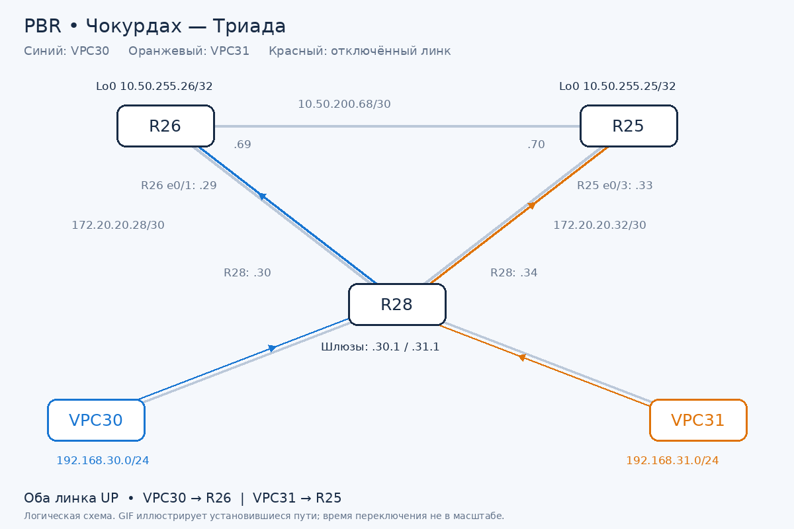
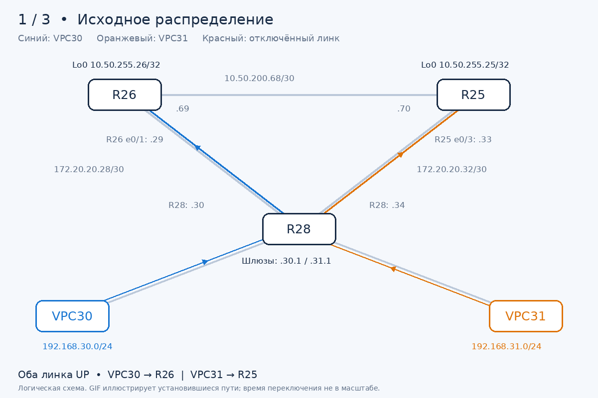

# PBR, резервирование каналов и маршрут по умолчанию

**Курс:** OTUS «Сетевой инженер. Продвинутый уровень»  
**Среда:** EVE-NG, Cisco IOS, VPCS

## Цель работы

Настроить политику маршрутизации в офисе Чокурдах и распределить трафик между двумя линками.Обеспечить переключение на резервный канал при отказе основного. Проверить доступность loopback-интерфейсов R25 и R26, а также возврат к исходному распределению после восстановления каналов. Настроить маршрут по умолчанию на R27 в Лабытнанги через R25 (Триада).

Отчёт охватывает выполненный этап настройки PBR, статической маршрутизации и IP SLA.Предоставлены полные конфигурации R25, R26, R27, R28 и SW29. В целях детальной визуализации сетевых процессов в состав отчёта включены динамические иллюстрации (в формате .gif)
## 1. Топология и адресация



Синий цвет обозначает трафик **VPC30**, оранжевый — **VPC31**. Схема логическая: коммутатор доступа SW29 и VLAN-транк до R28 опущены для читаемости. Цветные стрелки показывают только направление запросов. Обратный путь проверен, работает.

| Участок / назначение | Сеть / адрес | Устройства |
|---|---|---|
| VLAN 10, VPC30 | `192.168.30.0/24` | Шлюз R28: `192.168.30.1` |
| VLAN 20, VPC31 | `192.168.31.0/24` | Шлюз R28: `192.168.31.1` |
| Суммарный маршрут к VPC | `192.168.30.0/23` | Обе пользовательские сети |
| R28 — R26 | `172.20.20.28/30` | R26: `.29`, R28: `.30` |
| R28 — R25 | `172.20.20.32/30` | R25: `.33`, R28: `.34` |
| R26 — R25 | `10.50.200.68/30` | R26: `.69`, R25: `.70` |
| Loopback0 R26 | `10.50.255.26/32` | Цель проверки связности |
| Loopback0 R25 | `10.50.255.25/32` | Цель проверки связности |


## 2. Концепция разделения трафика

PBR на R28 выбирает следующий узел по источнику пакета:

| Источник | Политика | Основной next-hop | Резервный next-hop |
|---|---|---|---|
| VPC30, `192.168.30.0/24` | `PBR_FOR_VPC30` | R26, `172.20.20.29`, track 2 | R25, `172.20.20.33`, track 1 |
| VPC31, `192.168.31.0/24` | `PBR_FOR_VPC31` | R25, `172.20.20.33`, track 1 | R26, `172.20.20.29`, track 2 |

Это распределение по источнику, а не балансировка ECMP. При исправных каналах каждый VPC использует свой основной выход. При отказе одного канала оба VPC могут использовать оставшийся. При восстановлении основного track политика снова предпочитает основной next-hop.

ACL `VPC30` и `VPC31`, указанные в `match ip address`, выбирают пакеты для PBR. Они не заменяют фильтрующие ACL `VLAN10_IN` и `VLAN20_IN`, применённые через `ip access-group`. Фильтрация должна разрешать проверяемые loopback-адреса. В актуальных `VLAN10_IN` и `VLAN20_IN` разрешены назначения в собственной пользовательской сети, `172.20.20.0/24` и `10.0.0.0/8`, затем установлен `deny ip any any`. Таким образом, loopback Триады разрешены правилом для `10.0.0.0/8`. Полный текст ACL приведён в [конфигурации R28](configs/R28.cfg).


## 3. Маршруты на R25 и R26

Линк междк машрутизаторами R25-R26 позволяет достичь loopback соседа через Триаду. Основные обратные маршруты ведут напрямую к R28, резервные — через соседний маршрутизатор.

### R25

```cisco
! Loopback R26 через межмаршрутизаторный линк
ip route 10.50.255.26 255.255.255.255 10.50.200.69
! Основной путь к обеим пользовательским сетям, AD по умолчанию 1
ip route 192.168.30.0 255.255.254.0 172.20.20.34
! Резервный обратный путь через R26, AD 30
ip route 192.168.30.0 255.255.254.0 10.50.200.69 30
```

### R26

```cisco
! Loopback R25 через межмаршрутизаторный линк
ip route 10.50.255.25 255.255.255.255 10.50.200.70
! Основной путь к обеим пользовательским сетям, AD по умолчанию 1
ip route 192.168.30.0 255.255.254.0 172.20.20.30
! Резервный обратный путь через R25, AD 30
ip route 192.168.30.0 255.255.254.0 10.50.200.70 30
```

Префикс `/23` объединяет `192.168.30.0/24` и `192.168.31.0/24`. Резервный маршрут с AD 30 используется, когда основной маршрут к тому же префиксу становится непригоден и исключается из таблицы.

**Обратный путь при отказе R26–R28:** R26 → R25 → R28 → VPC30.  
**Обратный путь при отказе R25–R28:** R25 → R26 → R28 → VPC31.

При исправных линках допустима асимметрия. Например, запрос VPC30 к loopback R25 идёт R28 → R26 → R25, а ответ R25 отправляет напрямую к R28.

## 4. IP SLA и track на R28

Важно: **IP SLA проверяет ближайший интерфейс соседа**, а **трассировка с VPC проверяет доступность loopback**. Loopback остаётся доступным через другой интерфейс маршрутизатора и подходит для демонстрации обходного пути.

| Операция | Назначение ICMP Echo | Источник на R28 | Track |
|---|---|---|---|
| IP SLA 1 | `172.20.20.33` — R25 | `172.20.20.34` | 1 |
| IP SLA 2 | `172.20.20.29` — R26 | `172.20.20.30` | 2 |

```cisco
track 1 ip sla 1 reachability
 delay down 10 up 15
track 2 ip sla 2 reachability
 delay down 10 up 15
!
ip sla 1
 icmp-echo 172.20.20.33 source-ip 172.20.20.34
 frequency 5
ip sla schedule 1 life forever start-time now
!
ip sla 2
 icmp-echo 172.20.20.29 source-ip 172.20.20.30
 frequency 5
ip sla schedule 2 life forever start-time now
```

Проверки запускаются каждые 5 секунд. Переход track в Down задерживается на 10 секунд, в Up — на 15 секунд. Это не измеренное полное время переключения: на него также влияют момент очередной проверки и ожидание её результата.


## 5. PBR с отслеживанием доступности

```cisco
route-map PBR_FOR_VPC30 permit 10
 match ip address VPC30
 set ip next-hop verify-availability 172.20.20.29 10 track 2
 set ip next-hop verify-availability 172.20.20.33 20 track 1
!
route-map PBR_FOR_VPC31 permit 10
 match ip address VPC31
 set ip next-hop verify-availability 172.20.20.33 10 track 1
 set ip next-hop verify-availability 172.20.20.29 20 track 2
```


### Состояние перед тестами — фактический вывод

```text
route-map PBR_FOR_VPC31, permit, sequence 10
  Match clauses:
    ip address (access-lists): VPC31
  Set clauses:
    ip next-hop verify-availability 172.20.20.33 10 track 1  [up]
    ip next-hop verify-availability 172.20.20.29 20 track 2  [up]
  Policy routing matches: 56 packets, 5880 bytes
route-map PBR_FOR_VPC30, permit, sequence 10
  Match clauses:
    ip address (access-lists): VPC30
  Set clauses:
    ip next-hop verify-availability 172.20.20.29 10 track 2  [up]
    ip next-hop verify-availability 172.20.20.33 20 track 1  [up]
  Policy routing matches: 67 packets, 7098 bytes
```

Оба track показывали `Reachability is Up`, код операции `OK`, RTT 1 мс. Счётчики route-map подтверждают совпадения трафика с политиками, но сами по себе не измеряют потери и время переключения. Поле `Tracked by: Route Map 0` — служебный вывод IOS, а не имя настроенной политики.

## 6. Проверки связности и резервирования

### Базовая связность

| Источник | Цель | Подтверждённый путь |
|---|---|---|
| VPC30 | `10.50.255.26` | R28 → R26 |
| VPC30 | `10.50.255.25` | R28 → R26 → R25 |
| VPC31 | `10.50.255.25` | R28 → R25 |
| VPC31 | `10.50.255.26` | R28 → R25 → R26 |

В ходе подготовки на R26 отсутствовал маршрут к loopback R25, поэтому трассировка возвращала `Destination host unreachable`. После добавления `/32` через `10.50.200.70` связность появилась. На R25 добавлен зеркальный маршрут через `10.50.200.69`.

Для проверок использовалась ICMP-трассировка VPCS с `-P 1`. В первоначальной UDP-трассировке ответ `ICMP type 3, code 3 — Destination port unreachable` от конечного маршрутизатора означал достижение закрытого UDP-порта, а не доказательство блокировки ACL.

### Тест 1. Отказ R26 e0/1 и восстановление



GIF — иллюстрация установившихся путей, основанная на трассировках. Она не является захватом пакетов; задержки SLA и потери в переходный момент не воспроизводятся.

На R26 отключён `Ethernet0/1` в сторону R28. С VPC30 выполнена проверка loopback R26:

```text
VPC30> trace 10.50.255.26 -P 1
 1   192.168.30.1   0.473 ms  0.327 ms  0.354 ms
 2   172.20.20.33   0.609 ms  0.409 ms  0.377 ms
 3   10.50.255.26   0.734 ms  0.656 ms  0.573 ms
```

**Результат:** VPC30 → R28 → R25 → R26. Доступ к loopback сохранился через резервный канал. Ответы подтверждают обратную связность; сама трассировка не отображает обратный маршрут.

После включения интерфейса:

```text
VPC30> trace 10.50.255.26 -P 1
 1   192.168.30.1   0.827 ms  0.436 ms  0.404 ms
 2   10.50.255.26   0.600 ms  0.458 ms  0.498 ms
```

**Результат:** восстановлен основной путь R28 → R26.

### Тест 2. Отказ R25 e0/3 и восстановление


На R25 отключён `Ethernet0/3` в сторону R28. С VPC31 выполнена проверка loopback R25:

```text
VPC31> trace 10.50.255.25 -P 1
 1   192.168.31.1   0.681 ms  0.428 ms  0.313 ms
 2   172.20.20.29   0.639 ms  0.547 ms  0.490 ms
 3   10.50.255.25   0.679 ms  0.533 ms  0.642 ms
```

**Результат:** VPC31 → R28 → R26 → R25. Доступ к loopback сохранился через резервный канал.

После включения интерфейса:

```text
VPC31> trace 10.50.255.25 -P 1
 1   192.168.31.1   0.918 ms  0.565 ms  0.541 ms
 2   10.50.255.25   0.857 ms  0.569 ms  0.710 ms
```

**Результат:** восстановлен основной путь R28 → R25.

### Почему отключали интерфейсы со стороны Триады

Плавающий статический маршрут не проверяет доступность соседа самостоятельно. Для проведённых тестов интерфейс отключали на R25/R26, чтобы основной обратный маршрут через прямое соединение к R28 становился непригодным.

IP SLA на R28 не управляет таблицами маршрутизации R25/R26. Если отключить только сторону R28, а в виртуальной среде противоположный интерфейс останется Up, основной обратный маршрут на стороне Триады может сохраниться и ответы будут теряться. Защита от такого отказа потребует отдельного механизма обнаружения на R25/R26.

## 6.1. Лабытнанги: маршрут по умолчанию на R27

Настроен маршрут по умолчанию. Указывает на адрес R25 в непосредственно подключённой подсети.
| Параметр | Значение |
|---|---|
| Площадка | Лабытнанги |
| Маршрутизатор | R27 |
| Loopback0 | `10.40.255.27/32` |
| Линк к Триаде | R27 `Ethernet0/0` ↔ R25 `Ethernet0/1` |
| Сеть линка | `172.20.20.36/30` |
| Адрес R27 | `172.20.20.38/30` |
| Next-hop R25 | `172.20.20.37` |
| Маршрут | `0.0.0.0/0` через R25 |

Фактические строки из [полной конфигурации R27](configs/R27.cfg):

```cisco
interface Ethernet0/0
 no shutdown
 description P2P_to_R25_e0/1
 ip address 172.20.20.38 255.255.255.252
!
ip route 0.0.0.0 0.0.0.0 172.20.20.37
```

Если для назначения нет более специфичного маршрута, R27 отправляет пакет через R25. Собственные connected-маршруты остаются предпочтительными по длине префикса. На R25 подтверждён адрес `172.20.20.37/30` на `Ethernet0/1`.


## 7. Результат работы

- В конфигурации R27 (Лабытнанги) подтверждён маршрут по умолчанию через R25.
- Разделение трафика по источнику сохранено: VPC30 предпочитает R26, VPC31 — R25.
- Настроены маршруты к loopback соседнего маршрутизатора через линк R25–R26.
- На R25/R26 подготовлены резервные обратные маршруты к `192.168.30.0/23` с AD 30.
- IP SLA и track связаны с next-hop в существующих route-map.
- Трассировками подтверждены обходные пути при поочерёдном отключении каждого линка и возврат к основным путям после восстановления.


## 8. Справочник команд

Команды приведены без конкретных IP-адресов. Это справочник синтаксиса, а готовые настройки находятся в полных конфигурациях ниже.

### Настройка: интерфейсы и VLAN

| Команда | Назначение |
|---|---|
| `configure terminal` | Вход в глобальный режим конфигурации IOS |
| `interface <интерфейс>` | Выбор физического интерфейса, подынтерфейса, Loopback или SVI для настройки |
| `description <текст>` | Подпись назначения интерфейса |
| `ip address <адрес> <маска>` | Назначение IP-адреса интерфейсу |
| `no ip address` | Удаление IP-адреса с интерфейса; на родительском интерфейсе VLAN-транка адреса расположены на подынтерфейсах |
| `encapsulation dot1Q <VLAN>` | Привязка подынтерфейса маршрутизатора к тегу VLAN |
| `switchport mode access` | Перевод порта коммутатора в режим access для подключения VPC |
| `switchport access vlan <VLAN>` | Назначение VLAN access-порту |
| `switchport trunk encapsulation dot1q` | Выбор 802.1Q на коммутаторе, поддерживающем эту команду |
| `switchport mode trunk` | Перевод порта в режим VLAN-транка |
| `switchport trunk allowed vlan <список>` | Определение VLAN, разрешённых на транке |
| `shutdown` / `no shutdown` | Отключение / включение интерфейса; использовались для тестов отказа и восстановления |

### Настройка: ACL и статические маршруты

| Команда | Назначение |
|---|---|
| `ip route <сеть> <маска> <next-hop> [AD] [name <имя>]` | Создание статического маршрута, в том числе маршрута по умолчанию (нулевые сеть и маска). Для loopback используется маска одного узла; повышенная AD задаёт резервный маршрут, `name` — его подпись |
| `ip access-list standard <имя>` | Создание стандартной ACL; в этой работе выбирает источник трафика для PBR |
| `permit <источник> <wildcard>` | Разрешающее условие стандартной ACL для сети источника |
| `ip access-list extended <имя>` | Создание расширенной ACL для фильтрации трафика |
| `permit ip <источник> <wildcard> <назначение> <wildcard>` | Разрешение IP-трафика между указанными сетями в расширенной ACL |
| `deny ip any any` | Явный запрет остального IP-трафика в фильтрующей ACL |
| `ip access-group <ACL> in` | Применение фильтрующей ACL к входящим пакетам интерфейса |

### Настройка: IP SLA, track и PBR

| Команда | Назначение |
|---|---|
| `ip sla <номер>` | Создание или редактирование операции проверки |
| `icmp-echo <цель> source-ip <источник>` | Выбор ICMP Echo и адреса источника проверки |
| `frequency <секунды>` | Период запуска операции IP SLA |
| `ip sla schedule <номер> life forever start-time now` | Немедленный запуск операции без ограничения срока работы |
| `track <номер> ip sla <номер-SLA> reachability` | Связь состояния track с доступностью цели IP SLA |
| `delay down <секунды> up <секунды>` | Задержки перехода track в Down и Up |
| `route-map <имя> permit <секция>` | Создание или редактирование разрешающей секции политики |
| `match ip address <ACL>` | Выбор пакетов, к которым применяется секция route-map |
| `set ip next-hop <next-hop>` | Первоначальный вариант PBR без отслеживания доступности; заменён в итоговой конфигурации |
| `no set ip next-hop <next-hop>` | Удаление прежнего действия PBR перед переходом на track |
| `set ip next-hop verify-availability <next-hop> <порядок> track <номер>` | Выбор next-hop с учётом track; меньший порядок задаёт предпочтительного кандидата |
| `ip policy route-map <имя>` | Применение PBR к входящему трафику выбранного интерфейса |

### Диагностика

| Команда | Назначение |
|---|---|
| `show ip route [адрес-назначения]` | Просмотр всей таблицы маршрутизации или пути к конкретной цели |
| `show running-config \| section <шаблон>` | Вывод нужных секций текущей конфигурации; использовалась для IP SLA |
| `show ip sla statistics <номер>` | Результат проверки, RTT, счётчики успехов и ошибок |
| `show track <номер>` | Состояние Up/Down, задержки и потребители объекта отслеживания |
| `show route-map` | Условия и действия PBR, состояние отслеживаемых next-hop и счётчики совпадений |
| `ping <цель>` | Проверка доступности узла ICMP-запросами с VPCS |
| `trace <цель> [-P 1]` | Трассировка VPCS: без опции — UDP, с `-P 1` — ICMP; использовалась для сравнения путей |

### Навигация и сохранение

| Команда | Назначение |
|---|---|
| `do <команда-просмотра>` | Выполнение команды просмотра из режима конфигурации IOS |
| `exit` | Возврат на предыдущий уровень CLI |
| `end` | Выход из режима конфигурации в привилегированный режим |
| `copy running-config startup-config` | Сохранение текущей конфигурации для последующей загрузки; рекомендована по окончании тестов |


## 9. Полные конфигурации устройств


| Устройство | Файл | Что относится к работе |
|---|---|---|
| R25 | [R25.cfg](configs/R25.cfg) | Loopback, межмаршрутизаторный линк, основной и резервный обратные маршруты |
| R26 | [R26.cfg](configs/R26.cfg) | Loopback, межмаршрутизаторный линк, основной и резервный обратные маршруты |
| R27 | [R27.cfg](configs/R27.cfg) | Лабытнанги: интерфейс к R25 и маршрут по умолчанию |
| R28 | [R28.cfg](configs/R28.cfg) | Шлюзы VLAN, фильтрующие ACL, PBR, IP SLA, track |
| SW29 | [SW29.cfg](configs/SW29.cfg) | Access-порты VPC, транк до R28, интерфейс управления |

SW29 подключает VPC30 через `Ethernet0/0` в VLAN 10, VPC31 через `Ethernet0/1` в VLAN 20. Транк `Ethernet0/2` к R28 пропускает VLAN 10, 20 и 99. Адрес управления SW29 — `192.168.99.29/24` на `Vlan99`.

## Файлы схем

- [Статическая схема отказа R26](assets/r26_down.png)
- [Статическая схема отказа R25](assets/r25_down.png)
- [GIF: отказ и восстановление R26](assets/test-01.gif)
- [GIF: отказ и восстановление R25](assets/test-02.gif)


