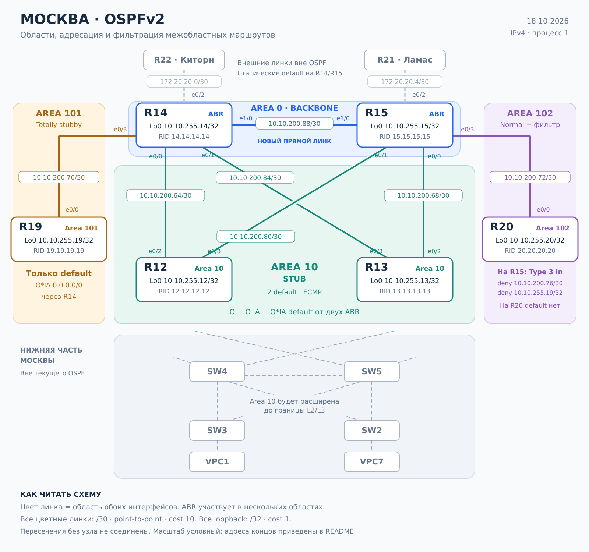

# OSPF: многозонная маршрутизация в Москве

Лабораторная работа курса **OTUS «Сетевой инженер. Продвинутый уровень»**.  
Состояние: **18 октября 2026 года**. Протокол: **OSPFv2 / IPv4**, процесс **1**. Платформа: Cisco IOS 15.4 (IOL), EVE-NG.

Реализованы backbone area 0, stub area 10, totally stubby area 101 и normal area 102 с фильтрацией межобластных объявлений. Проверены экспортированные конфигурации и предоставленные выводы команд шести маршрутизаторов.

> **Объём работы.** OSPF настроен на R12, R13, R14, R15, R19 и R20. IPv6 по решению автора не выполнялся: соответствующий пункт исходного задания не закрыт. Area 10 будет расширена вниз до границы L2/L3 на следующем этапе; в этой версии расширение ещё не выполнено. Суммаризация обсуждалась, но не настраивалась.

## Содержание

- [Задание и результат](#задание-и-результат)
- [Схема и границы областей](#схема-и-границы-областей)
- [Адресация](#адресация)
- [План и выполненные изменения](#план-и-выполненные-изменения)
- [Конфигурация OSPF](#конфигурация-ospf)
- [Фильтрация area 102](#фильтрация-area-102)
- [Проверки работающей сети](#проверки-работающей-сети)
- [Исправления при проверке](#исправления-при-проверке)
- [Ограничения и дополнительные проверки](#ограничения-и-дополнительные-проверки)
- [Файлы работы](#файлы-работы)

## Задание и результат

| Требование | Реализация | Подтверждение |
|---|---|---|
| R14–R15 в backbone area 0 | Прямой линк Ethernet1/0 ↔ Ethernet1/0 и loopback обоих устройств включены в area 0 | Конфигурации; интерфейсы P2P; соседство FULL с двух сторон |
| R12–R13 в area 10, получают маршруты и default | Обычная stub area 10, два ABR — R14/R15 | На каждом R12/R13 маршруты O, O IA и два next-hop для O*IA 0.0.0.0/0 |
| R19 в area 101, получает только default | Totally stubby: no-summary на ABR R14 | На R19 единственный маршрут OSPF — O*IA default |
| R20 в area 102, получает все маршруты кроме сетей area 101 | Normal area; фильтр LSA Type 3 на R15 внутрь area 102 | На R20 нет 10.10.200.76/30 и 10.10.255.19/32, остальные префиксы текущего OSPF-домена присутствуют |
| IPv6 повторяет IPv4 | Не выполнялось | Вне принятого объёма этой версии |
| Документировать план и изменения | Этот README, схема, конфигурации и выдержки проверок | Пакет подготовлен для размещения в GitHub; публикация отдельно |

Под «всеми маршрутами» здесь понимаются объявленные сети текущего OSPF-домена. Сети провайдерских линков и нижней части Москвы пока не объявляются в OSPF.

## Схема и границы областей



[Векторная схема SVG](assets/ospf-moscow.svg) · [Исходная схема Москвы](assets/source-moscow.png)

Область назначается **интерфейсу**. R14 одновременно участвует в областях 0, 10 и 101, R15 — в 0, 10 и 102. Поэтому R14/R15 обозначены как ABR на границах областей; их loopback входят в area 0. Цвет соединения определяет область обоих его интерфейсов. Пересечение линий не означает соединения.

| Область | Тип | Устройства и роли | Информация, поступающая из других областей |
|---|---|---|---|
| 0 | Backbone / normal | R14, R15 — ABR | Межобластные маршруты; внешние LSA в текущей реализации отсутствуют |
| 10 | Stub | R12/R13 — внутренние; R14/R15 — ABR | O IA и default O*IA от каждого ABR; Type 5 не допускаются |
| 101 | Totally stubby | R19 — внутренний; R14 — ABR | Только default Type 3; собственная топология области сохраняется |
| 102 | Normal | R20 — внутренний; R15 — ABR | Межобластные маршруты за исключением двух префиксов area 101 |

Прямое соединение R14–R15 добавлено для связности area 0 в выбранной архитектуре. Альтернативный путь между ними через area 10 не является соединением backbone. Virtual Link не используется.

## Адресация

### Loopback и Router ID

Router ID задан явно и отличается от IP loopback. Router ID идентифицирует узел в OSPF, а включение Loopback0 в процесс обеспечивает объявление его IP.

| Устройство | Router ID | Loopback0 | Area |
|---|---|---|---:|
| R12 | 12.12.12.12 | 10.10.255.12/32 | 10 |
| R13 | 13.13.13.13 | 10.10.255.13/32 | 10 |
| R14 | 14.14.14.14 | 10.10.255.14/32 | 0 |
| R15 | 15.15.15.15 | 10.10.255.15/32 | 0 |
| R19 | 19.19.19.19 | 10.10.255.19/32 | 101 |
| R20 | 20.20.20.20 | 10.10.255.20/32 | 102 |

### Межроутерные соединения

Все перечисленные линки имеют маску /30 и тип OSPF **point-to-point**. Из предоставленных выводов: cost каждого Ethernet-интерфейса — 10, loopback — 1; reference bandwidth — 100 Мбит/с.

| Сеть | Первый конец | IP | Второй конец | IP | Area |
|---|---|---|---|---|---:|
| 10.10.200.88/30 | R14 e1/0 | 10.10.200.89 | R15 e1/0 | 10.10.200.90 | 0 |
| 10.10.200.64/30 | R14 e0/0 | 10.10.200.66 | R12 e0/2 | 10.10.200.65 | 10 |
| 10.10.200.84/30 | R14 e0/1 | 10.10.200.86 | R13 e0/3 | 10.10.200.85 | 10 |
| 10.10.200.68/30 | R15 e0/0 | 10.10.200.70 | R13 e0/2 | 10.10.200.69 | 10 |
| 10.10.200.80/30 | R15 e0/1 | 10.10.200.82 | R12 e0/3 | 10.10.200.81 | 10 |
| 10.10.200.76/30 | R14 e0/3 | 10.10.200.78 | R19 e0/0 | 10.10.200.77 | 101 |
| 10.10.200.72/30 | R15 e0/3 | 10.10.200.74 | R20 e0/0 | 10.10.200.73 | 102 |

### Соединения вне текущего OSPF

| Соединение | Сеть | Адреса | Статус |
|---|---|---|---|
| R14 e0/2 ↔ R22 e0/0 | 172.20.20.0/30 | .1 ↔ .2 | Внешний линк; на R14 статический default через .2 |
| R15 e0/2 ↔ R21 e0/0 | 172.20.20.4/30 | .5 ↔ .6 | Внешний линк; на R15 статический default через .6 |
| R12 e0/0 ↔ SW4 e1/0 | 10.10.200.0/30 | .2 ↔ .1 | Не включено в OSPF |
| R12 e0/1 ↔ SW5 e1/1 | 10.10.200.8/30 | .10 ↔ .9 | Не включено в OSPF |
| R13 e0/0 ↔ SW5 e1/0 | 10.10.200.4/30 | .6 ↔ .5 | Не включено в OSPF |
| R13 e0/1 ↔ SW4 e1/1 | 10.10.200.12/30 | .14 ↔ .13 | Не включено в OSPF |

## План и выполненные изменения

1. Проверить адресацию и распределить интерфейсы по областям.
2. Добавить прямой линк R14–R15 через e1/0, назначить 10.10.200.89/30 и 10.10.200.90/30, включить в area 0.
3. Включить процесс OSPF 1, назначить уникальные Router ID и объявить loopback /32.
4. На семи OSPF-соединениях установить point-to-point с обеих сторон. DR/BDR на этих линках не выбираются.
5. Настроить stub area 10 на R12/R13/R14/R15. ABR автоматически создают default с метрикой 1.
6. Настроить totally stubby area 101: stub на R19, stub no-summary на R14.
7. Настроить normal area 102 на R15/R20; на R15 отфильтровать две сети area 101 при объявлении Type 3 внутрь area 102.
8. Удалить экспериментальные default-information originate с R14/R15. Локальные статические default сохранены, но внешние default в OSPF больше не создаются.
9. Проверить соседства, области и таблицы маршрутизации. Исправить маску loopback R13 и next-hop статического default R14; сохранить исправления в экспорте.
10. Подготовить документацию и схему по фактической конфигурации.

## Конфигурация OSPF

Ниже — точные фрагменты секций OSPF из предоставленного экспорта. Полные документальные копии конфигураций находятся в `configs/`; строки локальной аутентификации в них опущены.

На физических линках процесс включён через `network <сеть> <wildcard> area <номер>`. Маска `0.0.0.3` выбирает интерфейсы указанной /30. На loopback применена интерфейсная команда `ip ospf 1 area ...`. Такое сочетание допустимо и отражает выполненную настройку.

### R14

```cisco
interface Loopback0
 no shutdown
 ip address 10.10.255.14 255.255.255.255
 ip ospf 1 area 0
!
router ospf 1
 router-id 14.14.14.14
 area 10 stub
 area 101 stub no-summary
 network 10.10.200.64 0.0.0.3 area 10
 network 10.10.200.76 0.0.0.3 area 101
 network 10.10.200.84 0.0.0.3 area 10
 network 10.10.200.88 0.0.0.3 area 0
```

### R15

```cisco
interface Loopback0
 no shutdown
 ip address 10.10.255.15 255.255.255.255
 ip ospf 1 area 0
!
router ospf 1
 router-id 15.15.15.15
 area 10 stub
 area 102 filter-list prefix FILTER_IP_FROM_AREA101 in
 network 10.10.200.68 0.0.0.3 area 10
 network 10.10.200.72 0.0.0.3 area 102
 network 10.10.200.80 0.0.0.3 area 10
 network 10.10.200.88 0.0.0.3 area 0
```

### R12

```cisco
interface Loopback0
 no shutdown
 ip address 10.10.255.12 255.255.255.255
 ip ospf 1 area 10
!
router ospf 1
 router-id 12.12.12.12
 area 10 stub
 network 10.10.200.64 0.0.0.3 area 10
 network 10.10.200.80 0.0.0.3 area 10
```

### R13

```cisco
interface Loopback0
 no shutdown
 ip address 10.10.255.13 255.255.255.255
 ip ospf 1 area 10
!
router ospf 1
 router-id 13.13.13.13
 area 10 stub
 network 10.10.200.68 0.0.0.3 area 10
 network 10.10.200.84 0.0.0.3 area 10
```

### R19

```cisco
interface Loopback0
 no shutdown
 ip address 10.10.255.19 255.255.255.255
 ip ospf 1 area 101
!
router ospf 1
 router-id 19.19.19.19
 area 101 stub
 network 10.10.200.76 0.0.0.3 area 101
```

### R20

```cisco
interface Loopback0
 no shutdown
 ip address 10.10.255.20 255.255.255.255
 ip ospf 1 area 102
!
router ospf 1
 router-id 20.20.20.20
 network 10.10.200.72 0.0.0.3 area 102
```

На каждом физическом OSPF-интерфейсе дополнительно задано:

```cisco
ip ospf network point-to-point
```

Команда задаёт тип сети OSPF; маска IP /30 сама по себе не отключает выборы DR/BDR.

### Как создаются default

На R14 и R15 нет `default-information originate` и редистрибуции. Их локальные статические маршруты:

```cisco
! R14
ip route 0.0.0.0 0.0.0.0 172.20.20.2
! R15
ip route 0.0.0.0 0.0.0.0 172.20.20.6
```

В area 10 оба ABR создают **отдельные LSA Type 3 для 0.0.0.0/0** как часть механизма stub. Стоимость default на R12/R13: 10 до ABR + 1 объявленной метрики = 11. Поэтому установлены два равноценных next-hop — ECMP. Это не гарантирует деление трафика строго 50/50.

В area 101 R14 аналогично создаёт default Type 3. `no-summary` блокирует обычные межобластные объявления внутрь area 101, но сохраняет default. Собственные сети area 101 при этом объявляются наружу.

Наличие stub-default не зависит от существования локального default на ABR и само по себе не подтверждает работоспособность внешнего выхода. В текущей реализации R14/R15 — ABR, а не ASBR: внешние маршруты ими в OSPF не импортируются.

## Фильтрация area 102

На **R15**:

```cisco
ip prefix-list FILTER_IP_FROM_AREA101 seq 20 deny 10.10.200.76/30
ip prefix-list FILTER_IP_FROM_AREA101 seq 21 deny 10.10.255.19/32
ip prefix-list FILTER_IP_FROM_AREA101 seq 30 permit 0.0.0.0/0 le 32
!
router ospf 1
 area 102 filter-list prefix FILTER_IP_FROM_AREA101 in
```

- Первые две строки запрещают **точные** префиксы линка R14–R19 и loopback R19.
- `permit 0.0.0.0/0 le 32` разрешает все остальные IPv4-префиксы, а не только default.
- `in` относится к направлению **внутрь area 102**, а не к входящему трафику физического интерфейса.
- R15 сохраняет эти маршруты в своей таблице, но не создаёт соответствующие Type 3 в area 102.
- Фильтр применяется к LSA Type 3 и не фильтрует Type 5. В текущем домене внешних LSA нет.

**Фильтрация маршрутов не является ACL.** При наличии default или другого покрывающего маршрута R20 мог бы отправлять пакеты в area 101 даже без двух конкретных префиксов. Сейчас на R20 нет ни этих префиксов, ни default, ни другого покрывающего маршрута. Ping R20 → 10.10.255.19 с источником Loopback0 завершился с результатом 0/5, что согласуется с таблицей маршрутизации. Появление покрывающего маршрута может изменить результат: фильтр объявлений не является запретом передачи пакетов.

Удаление default-information originate было дополнительным выбором автора; для буквального требования «не получать маршруты до сетей area 101» достаточно Type 3-фильтра. На R12/R13 и R19 stub-default сохранились.

## Проверки работающей сети

Источник этой части — предоставленные пользователем выводы CLI 18.10.2026, а не запуск команд из отчёта. Последние выводы R13/R14 после исправлений имеют приоритет над первоначальными. [Выдержки и статус проверок](evidence/verification.md).

### Соседства

| Устройство | Соседи по Router ID | Количество | Результат |
|---|---|---:|---|
| R14 | 15.15.15.15, 13.13.13.13, 12.12.12.12, 19.19.19.19 | 4 | Все FULL/- |
| R15 | 14.14.14.14, 12.12.12.12, 13.13.13.13, 20.20.20.20 | 4 | Все FULL/- |
| R12 | 15.15.15.15, 14.14.14.14 | 2 | Оба FULL/- |
| R13 | 14.14.14.14, 15.15.15.15 | 2 | Оба FULL/- |
| R19 | 14.14.14.14 | 1 | FULL/- |
| R20 | 15.15.15.15 | 1 | FULL/- |

Это семь двусторонне подтверждённых соседств. Предыдущее отображение BDR на R20 больше не наблюдается: в итоговом выводе тип интерфейса P2P и сосед FULL/-.

### R19: только default

```text
O*IA  0.0.0.0/0 [110/11] via 10.10.200.78, 00:46:13, Ethernet0/0
C        10.10.200.76/30 is directly connected, Ethernet0/0
L        10.10.200.77/32 is directly connected, Ethernet0/0
C        10.10.255.19/32 is directly connected, Loopback0
```

Единственный изученный OSPF-маршрут — default через R14. Connected/local остаются, поскольку относятся к собственным интерфейсам. На R14 для area 101 явно указано `It is a stub area, no summary LSA in this area`; R19 сообщает просто `It is a stub area`, что нормально для внутреннего роутера.

### R12 и R13: stub с двумя ABR

R12:

```text
O*IA  0.0.0.0/0 [110/11] via 10.10.200.82, 00:55:07, Ethernet0/3
                [110/11] via 10.10.200.66, 00:55:07, Ethernet0/2
```

R13 после исправления:

```text
O*IA  0.0.0.0/0 [110/11] via 10.10.200.86, 01:10:00, Ethernet0/3
                [110/11] via 10.10.200.70, 01:10:10, Ethernet0/2
```

На обоих также присутствуют O к loopback другого внутреннего роутера area 10 и O IA к loopback R14, R15, R19, R20. Наличие сетей area 101 здесь корректно: фильтр ограничивает только area 102. Строка Gateway of last resort с одним адресом не отменяет наличие второго next-hop в записи default.

### R20: результат фильтрации

В полной таблице: `Gateway of last resort is not set`. Есть девять межобластных маршрутов:

| Префикс | Метрика OSPF | Next-hop |
|---|---:|---|
| 10.10.200.64/30 | 30 | 10.10.200.74 |
| 10.10.200.68/30 | 20 | 10.10.200.74 |
| 10.10.200.80/30 | 20 | 10.10.200.74 |
| 10.10.200.84/30 | 30 | 10.10.200.74 |
| 10.10.200.88/30 | 20 | 10.10.200.74 |
| 10.10.255.12/32 | 21 | 10.10.200.74 |
| 10.10.255.13/32 | 21 | 10.10.200.74 |
| 10.10.255.14/32 | 21 | 10.10.200.74 |
| 10.10.255.15/32 | 11 | 10.10.200.74 |

Префиксы **10.10.200.76/30 и 10.10.255.19/32 отсутствуют**. На R15 они сохранены как O IA. Вместе с применённым filter-list это подтверждает ожидаемый результат фильтрации в таблице R20. Дополнительно получен детальный вывод Type 3 LSDB: оба префикса отсутствуют и в базе area 102.

### Проверка связности между loopback

Тесты выполнены пользователем с `source Loopback0` 18.10.2026. Проверяется прохождение Echo Request и возврат Echo Reply к loopback источника. [Зафиксированные результаты](evidence/ping-results.md).

| Источник | Назначение | Результат | RTT min/avg/max, мс |
|---|---|---|---|
| R12 (10.10.255.12) | R13 (10.10.255.13) | 5/5 — 100% | 1/1/1 |
| R12 (10.10.255.12) | R19 (10.10.255.19) | 5/5 — 100% | 1/1/1 |
| R12 (10.10.255.12) | R20 (10.10.255.20) | 5/5 — 100% | 1/1/1 |
| R20 (10.10.255.20) | R12 (10.10.255.12) | 5/5 — 100% | 1/1/1 |
| R20 (10.10.255.20) | R19 (10.10.255.19) | 0/5 — ожидаемая недоступность | — |
| R14 (10.10.255.14) | R15 (10.10.255.15) | 5/5 — 100% | 1/1/1 |
| R14 (10.10.255.14) | R20 (10.10.255.20) | 5/5 — 100% | 1/1/2 |
| R15 (10.10.255.15) | R14 (10.10.255.14) | 5/5 — 100% | 1/1/1 |
| R15 (10.10.255.15) | R19 (10.10.255.19) | 5/5 — 100% | 1/1/1 |

Получено восемь успешных межроутерных тестов и один ожидаемо неуспешный. R12 → R19 подтверждает также обратную передачу ответов из totally stubby area 101. R15 → R19 показывает, что сам ABR достигает area 101, хотя не объявляет её сети в area 102.

Полный результат R12 → R20 предоставлен отдельно: 5/5, RTT 1/1/1 мс. Обратный тест R20 → R12 также успешен. Ping R15 → 10.10.255.15 — проверка собственного адреса; в число межроутерных тестов он не включён.

Неудачный ping сам по себе не доказывает механизм фильтрации. Здесь он согласуется с filter-list на R15 и отсутствием конкретного и покрывающего маршрутов на R20. Детальный вывод Type 3 LSDB подтверждает отсутствие объявлений area 101 в area 102. Ping не проверяет отказоустойчивость или все варианты ECMP.

### R20: детальная проверка LSA Type 3

В предоставленном `show ip ospf database summary` для **Area 102** присутствуют девять LSA Type 3, все от **Advertising Router 15.15.15.15 (R15)**. Полный состав зафиксирован в [выводе LSDB](evidence/r20-lsdb.md).

| Link State ID / маска | Метрика в LSA | Стоимость R20 → R15 | Итоговая метрика O IA на R20 |
|---|---:|---:|---:|
| 10.10.200.64/30 | 20 | 10 | 30 |
| 10.10.200.68/30 | 10 | 10 | 20 |
| 10.10.200.80/30 | 10 | 10 | 20 |
| 10.10.200.84/30 | 20 | 10 | 30 |
| 10.10.200.88/30 | 10 | 10 | 20 |
| 10.10.255.12/32 | 11 | 10 | 21 |
| 10.10.255.13/32 | 11 | 10 | 21 |
| 10.10.255.14/32 | 11 | 10 | 21 |
| 10.10.255.15/32 | 1 | 10 | 11 |

Объявления **10.10.200.76/30 и 10.10.255.19/32 отсутствуют в LSDB area 102**. Это подтверждает, что фильтр на ABR R15 не допускает соответствующие Type 3 в область, а не просто исключает маршруты из локальной RIB R20. LSA Type 3 для default также нет; в повторном show ip route — `Gateway of last resort is not set`.

Метрика в Type 3 отражает объявленную ABR стоимость. R20 прибавляет стоимость пути до ABR: например, для 10.10.255.12/32 получается 11 + 10 = 21. Это согласуется с его таблицей маршрутизации.

**Проверка выполнена на трёх уровнях:** префиксы area 101 отсутствуют в Type 3 LSDB; в RIB R20 нет конкретных или покрывающих маршрутов; ping R20 → loopback R19 даёт 0/5. Остальные девять межобластных маршрутов сохранены, а ping R20 → R12 успешен.

### LSDB: доступные сводные данные

| Область | Где наблюдается | Число LSA | Checksum Sum |
|---|---|---:|---|
| 0 | R14, R15 | 18 | 0x09A9E4 |
| 10 | R12, R13, R14, R15 | 20 | 0x0A6C48 |
| 101 | R14, R19 | 3 | 0x007745 |
| 102 | R15, R20 | 11 | 0x050AE9 |

Сводные значения из `show ip ospf` совпадают между участниками каждой области. Число внешних LSA на всех шести устройствах — 0. Эти сведения согласуются с настройкой, но не заменяют детальный разбор содержимого каждого LSA.

## Исправления при проверке

| Устройство | Было | Исправлено | Подтверждение |
|---|---|---|---|
| R13 Loopback0 | 10.10.255.13/30, лишний connected 10.10.255.12/30 | 10.10.255.13/32 | Новый CLI: Lo0 /32, C 10.10.255.13/32; исправление есть в UNL |
| R14 default | Next-hop 172.20.20.0 — адрес сети /30 | Next-hop 172.20.20.2 — адрес R22 | Новый show ip route 0.0.0.0 и конфигурации R14/R22 в UNL |

Ошибочная /30 на loopback не нарушала его объявление как /32 стандартным механизмом OSPF loopback, но не соответствовала плану адресации и создавала лишнюю connected-сеть. Ошибочный статический next-hop R14 не мешал созданию stub-default, однако был некорректен для внешней пересылки.

[Подробности проверки экспорта и косметические замечания](evidence/config-review.md).

## Ограничения и дополнительные проверки

Фактически подтверждены конфигурации, принадлежность интерфейсов к областям, состояние соседств, установленная маршрутизация и перечисленные выше проверки ping. **Traceroute, испытания отказов, проверка внешних выходов и нижней части Москвы не подтверждены предоставленными данными**; их успешность не заявляется.

При необходимости дополнить отчёт можно следующими проверками. Это команды для выполнения, а не уже полученные результаты.

| Где | Команда | Что проверяет |
|---|---|---|
| R14/R15 | `show ip ospf database summary 0.0.0.0` | Default Type 3 по областям, Advertising Router и метрики |
| R19 | `show ip ospf database summary` | Дополнительная детализация единственного default Type 3 в area 101; вывод R20 уже получен |
| R15 | `show ip prefix-list FILTER_IP_FROM_AREA101` | Правила действующего prefix-list |
| R19 | `ping 10.10.255.12 source Loopback0` | Передача через default из totally stubby |

Из-за единственного физического линка area 0 отказ R14–R15 разрывает backbone; испытания отказоустойчивости в эту версию не включены. Два default на R12/R13 подтверждают ECMP, но не являются доказательством полной отказоустойчивости всей схемы.

## Файлы работы

- `README.md` — отчёт.
- `assets/ospf-moscow.svg` — векторная схема с областями, портами и сетями.
- `assets/ospf-moscow.png` — схема для просмотра и вставки в GitHub.
- `assets/source-moscow.png` — исходный скриншот топологии.
- `configs/R12.cfg`, `R13.cfg`, `R14.cfg`, `R15.cfg`, `R19.cfg`, `R20.cfg` — извлечённые конфигурации без строк локальной аутентификации.
- `evidence/verification.md` — выдержки CLI и степень подтверждения результатов.
- `evidence/config-review.md` — проверка конфигураций и исправлений.
- `evidence/ping-results.md` — предоставленные результаты проверки связности.
- `evidence/r20-lsdb.md` — детальный вывод Type 3 LSDB и повторная таблица маршрутизации R20.

Для размещения в репозитории достаточно перенести папку целиком: относительные ссылки README сохранятся. Исходный файл лабы не изменён; конфигурации для отчёта извлечены из его актуальной версии.
