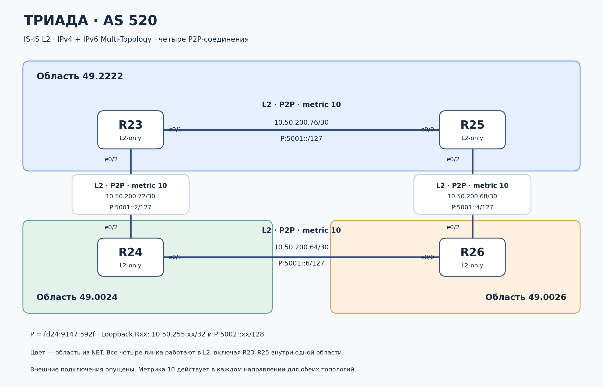

# IS-IS в сети «Триада»: IPv4 и IPv6


## 1. Результат и границы проверки

На четырёх маршрутизаторах настроен IS-IS Level 2 для IPv4 и IPv6. Все четыре внутренних соединения работают в режиме point-to-point. IPv6 использует отдельную топологию TID 2; IPv4 — базовую TID 0. На каждом роутере установлены два соседства Up, получены LSP остальных устройств и маршруты к трём удалённым loopback в обоих семействах адресов.

Подтверждены равнозначные пути ECMP между R23 и R26, а также между R24 и R25. В предоставленных материалах есть 23 завершённых проверки ping с источником Loopback0: все дали 100% (5/5).


## 2. Топология и области



Векторная версия: [triada_isis_areas.svg](images/triada_isis_areas.svg).

| Роутер | Область | NET | Режим |
|---|---|---|---|
| R23 | 49.2222 | 49.2222.0100.5025.5023.00 | level-2-only |
| R24 | 49.0024 | 49.0024.0100.5025.5024.00 | level-2-only |
| R25 | 49.2222 | 49.2222.0100.5025.5025.00 | level-2-only |
| R26 | 49.0026 | 49.0026.0100.5025.5026.00 | level-2-only |

R23 и R25 находятся в одной области 49.2222. R24 относится к 49.0024, R26 — к 49.0026. При этом все соседства — L2: одинаковая область не обязывает использовать L1, а разные области не мешают L2-соседству. Магистраль L2 непрерывна по кольцу R23–R25–R26–R24–R23. В данной реализации нет L1-роутеров.

Пример NET R24: `49.0024.0100.5025.5024.00`:

- `49.0024` — адрес области;
- `0100.5025.5024` — уникальный System ID из шести байт;
- `00` — NSEL для NET.

System ID соответствует принятой в лабораторной схеме: IPv4 loopback `10.50.255.24` записан как `010.050.255.024`, точки убраны, цифры сгруппированы по четыре: `0100.5025.5024`. Это ручное соглашение об идентификаторах, а не автоматический выбор или перевод IPv4-адреса в hex. NET общий для IPv4 и IPv6; добавлять второй NET для IPv6 не требуется.

## 3. Адресация

### 3.1. Внутренние соединения IPv4

| Линк | Подсеть | Первый конец | Второй конец |
|---|---|---|---|
| R23–R25 | 10.50.200.76/30 | R23 e0/1: 10.50.200.77/30 | R25 e0/0: 10.50.200.78/30 |
| R23–R24 | 10.50.200.72/30 | R23 e0/2: 10.50.200.73/30 | R24 e0/2: 10.50.200.74/30 |
| R25–R26 | 10.50.200.68/30 | R25 e0/2: 10.50.200.70/30 | R26 e0/2: 10.50.200.69/30 |
| R24–R26 | 10.50.200.64/30 | R24 e0/1: 10.50.200.66/30 | R26 e0/0: 10.50.200.65/30 |

### 3.2. Внутренние соединения IPv6

Под все внутренние P2P выделен один блок `fd24:9147:592f:5001::/64`. На интерфейсы назначаются отдельные `/127`, а не весь `/64`. Каждый `/127` содержит два адреса для концов линка.

| Линк | Подсеть /127 | Первый конец | Второй конец |
|---|---|---|---|
| R23 e0/1 — R25 e0/0 | fd24:9147:592f:5001::/127 | fd24:9147:592f:5001::/127 | fd24:9147:592f:5001::1/127 |
| R23 e0/2 — R24 e0/2 | fd24:9147:592f:5001::2/127 | fd24:9147:592f:5001::2/127 | fd24:9147:592f:5001::3/127 |
| R25 e0/2 — R26 e0/2 | fd24:9147:592f:5001::4/127 | fd24:9147:592f:5001::5/127 | fd24:9147:592f:5001::4/127 |
| R24 e0/1 — R26 e0/0 | fd24:9147:592f:5001::6/127 | fd24:9147:592f:5001::7/127 | fd24:9147:592f:5001::6/127 |

Адрес с нулевой хостовой частью `fd24:9147:592f:5001::/127` используется на R23. Для межмаршрутизаторного P2P `/127` оба адреса пары пригодны для назначения; broadcast в IPv6 отсутствует. Пары следуют по границам `/127`: `::`/`::1`, `::2`/`::3`, `::4`/`::5`, `::6`/`::7`.

### 3.3. Loopback0

Для loopback зарезервирован отдельный блок `fd24:9147:592f:5002::/64`. Каждому устройству назначен один `/128`. Общее резервирование не создаёт общий L2-сегмент между loopback.

| Роутер | IPv4 Loopback0 | IPv6 Loopback0 |
|---|---|---|
| R23 | 10.50.255.23/32 | fd24:9147:592f:5002::23/128 |
| R24 | 10.50.255.24/32 | fd24:9147:592f:5002::24/128 |
| R25 | 10.50.255.25/32 | fd24:9147:592f:5002::25/128 |
| R26 | 10.50.255.26/32 | fd24:9147:592f:5002::26/128 |

Окончания `23`–`26` выбраны как визуальные метки номеров роутеров. В IPv6 это шестнадцатеричные значения; преобразование номера устройства из десятичной системы не выполнялось.

## 4. Как сформирован IPv6-префикс

Один хекстет — группа из четырёх шестнадцатеричных цифр: 16 бит, или два октета. Для лабораторной выбран ULA-префикс, предназначенный для внутренней адресации.

**Генератор сформировал первые три хекстета `/48`. Четвёртый хекстет назначен вручную при планировании подсетей.**

На Kubuntu использован скрипт:

```bash
python3 - <<'PY'
import secrets
prefix = "fd" + secrets.token_hex(5)
print(":".join(prefix[i:i+4] for i in range(0, 12, 4)) + "::/48")
PY
```

| Элемент | Назначение |
|---|---|
| `python3 - <<'PY'` | Передать следующий блок кода Python через стандартный ввод; кавычки запрещают shell-подстановки в блоке |
| `import secrets` | Подключить генератор, использующий криптографически стойкий источник случайных данных ОС |
| `secrets.token_hex(5)` | Получить пять случайных байт — 40 бит Global ID, десять hex-цифр |
| `"fd" + ...` | Добавить фиксированные восемь бит начала локально назначаемого ULA |
| `prefix[i:i+4]` | Разделить 12 hex-цифр на три хекстета |
| `":".join(...) + "::/48"` | Оформить результат как IPv6-префикс `/48` |

Выбранный результат запуска: `fd24:9147:592f::/48`. В нём `fd` — фиксированное начало, а `24 91 47 59 2f` — пять байт Global ID. Случайный выбор уменьшает вероятность пересечения адресации с независимо созданной ULA-сетью. Скрипт печатает результат и не меняет настройки сетевых интерфейсов. Повторный запуск обычно даст другой префикс; для этой лабораторной сохранён первоначальный результат.

После генерации внутри `/48` под Триаду выделен блок `fd24:9147:592f:5000::/56`. В четвёртом хекстете первые две цифры `50` служат меткой Триады, по аналогии с `10.50.x.x`, а последние две цифры различают назначения:

| Поле | Значение | Как выбрано |
|---|---|---|
| Хекстеты 1–3 | `fd24:9147:592f` | Фиксированный байт `fd` и сгенерированные 40 бит |
| Хекстет 4 для P2P | `5001` | Метка Триады `50` + номер блока `01`, вручную |
| Хекстет 4 для loopback | `5002` | Метка Триады `50` + номер блока `02`, вручную |
| Полные адреса | `/127` на линках, `/128` на loopback | Статически назначены по таблицам выше |

Блок `/56` включает 256 блоков `/64`: четвёртый хекстет от `5000` до `50ff`. Это резерв адресного плана, а не автоматически созданный маршрут или настроенная суммаризация.

## 5. Применённые команды

Ниже фрагменты фактической конфигурации R23. Полные копии конфигураций всех четырёх устройств приведены в каталоге [configs](configs/).

```text
ipv6 unicast-routing
ipv6 cef
!
router isis TRIADA
 net 49.2222.0100.5025.5023.00
 is-type level-2-only
 metric-style wide
 passive-interface Loopback0
 !
 address-family ipv6
  multi-topology
 exit-address-family
```

| Команда | Что делает |
|---|---|
| `ipv6 unicast-routing` | Включает пересылку IPv6-пакетов маршрутизатором |
| `ipv6 cef` | Включает CEF для IPv6 |
| `router isis TRIADA` | Создаёт/открывает процесс с локальным тегом TRIADA |
| `net ...` | Задаёт область и уникальный System ID |
| `is-type level-2-only` | Ограничивает процесс уровнем L2 |
| `metric-style wide` | Включает расширенный формат метрик |
| `passive-interface Loopback0` | Объявляет адреса loopback без формирования на нём соседств |
| `address-family ipv6` | Открывает настройки IPv6 данного процесса |
| `multi-topology` | Включает отдельную IPv6-топологию TID 2 |
| `exit-address-family` | Возвращает в режим настройки процесса |

```text
interface Ethernet0/2
 description to_R24_e0/2
 ip address 10.50.200.73 255.255.255.252
 ip router isis TRIADA
 ipv6 address FD24:9147:592F:5001::2/127
 ipv6 router isis TRIADA
 isis network point-to-point
!
interface Loopback0
 ip address 10.50.255.23 255.255.255.255
 ipv6 address FD24:9147:592F:5002::23/128
```

| Команда | Что делает |
|---|---|
| `interface ...` | Выбирает интерфейс для настройки |
| `description ...` | Подписывает назначение соединения |
| `ip address ...` | Назначает IPv4-адрес и маску |
| `ip router isis TRIADA` | Включает IPv4 IS-IS на интерфейсе |
| `ipv6 address ...` | Назначает IPv6-адрес с длиной префикса |
| `ipv6 router isis TRIADA` | Включает IPv6 IS-IS на интерфейсе |
| `isis network point-to-point` | Задаёт P2P-представление Ethernet-соединения; DIS и псевдоузел для этого линка не требуются |

Отдельные `ip router isis` и `ipv6 router isis` на Loopback0 в итоговых конфигурациях отсутствуют. Его включение обеспечивается `passive-interface Loopback0` в процессе; объявления обоих адресов подтверждены LSP. Стоимость внутренних связей — 10 в каждом направлении; loopback объявляются с метрикой 0.

## 6. Проверка соседств и баз

| Роутер | Сосед 1 | Сосед 2 | Результат |
|---|---|---|---|
| R23 | R25 / Et0/1 | R24 / Et0/2 | оба Up, L2, IPv4 + IPv6 |
| R24 | R23 / Et0/2 | R26 / Et0/1 | оба Up, L2, IPv4 + IPv6 |
| R25 | R23 / Et0/0 | R26 / Et0/2 | оба Up, L2, IPv4 + IPv6 |
| R26 | R24 / Et0/0 | R25 / Et0/2 | оба Up, L2, IPv4 + IPv6 |

В `show clns neighbors detail` протокол отображён как `M-ISIS`, а список топологий — `IPv4, IPv6`. Общее соседство обслуживает обе топологии. На каждом устройстве присутствуют четыре обычных L2 LSP: `R23.00-00`–`R26.00-00`. Псевдоузлов нет, что согласуется с P2P-режимом всех внутренних линков.

Каждый LSP содержит две связи `IS-Extended` для IPv4 и две `IS (MT-IPv6)` для IPv6, две транзитные подсети каждого семейства и свой loopback. Флаги ATT/P/OL равны `0/0/0`. Для этой L2-only схемы ATT=0 ожидаем. Выводы снимались в разное время, поэтому номера версий и Holdtime могут отличаться; совпадение всех таймеров не является критерием синхронизации.

Пример собственных объявлений R24:

```text
Metric: 10  IS (MT-IPv6) R23.00
Metric: 10  IS (MT-IPv6) R26.00
Metric: 10  IPv6 (MT-IPv6) FD24:9147:592F:5001::6/127
Metric: 10  IPv6 (MT-IPv6) FD24:9147:592F:5001::2/127
Metric: 0   IPv6 (MT-IPv6) FD24:9147:592F:5002::24/128
```

Сначала формируется соседство через IIH, затем распространяются LSP и синхронизируются базы. SPF рассчитывает пути отдельно для TID 0 и TID 2, после чего выбранные префиксы устанавливаются в соответствующие IP-таблицы.

## 7. Маршруты и ECMP

Матрица метрик до удалённых loopback одинакова для IPv4 и IPv6:

| Источник / назначение | R23 | R24 | R25 | R26 |
|---|---|---|---|---|
| R23 | локальный | 10 | 10 | 20, два next-hop |
| R24 | 10 | локальный | 20, два next-hop | 10 |
| R25 | 10 | 20, два next-hop | локальный | 10 |
| R26 | 20, два next-hop | 10 | 10 | локальный |

Маршруты IPv4 имеют код `i L2`, IPv6 — `I2`. AD в установленных IP-маршрутах равна 115. При стоимости одного линка 10 и метрике loopback 0 путь до соседнего loopback равен 10, через два линка — 20.

Пример R26 → loopback R23 из фактического вывода:

```text
I2  FD24:9147:592F:5002::23/128 [115/20]
     via FE80::A8BB:CCFF:FE01:8010, Ethernet0/0
     via FE80::A8BB:CCFF:FE01:9020, Ethernet0/2
```

Первый next-hop — R24, второй — R25. Оба пути имеют стоимость 20. Указание link-local вместе с интерфейсом определяет ближайшего соседа. IPv6-адрес назначения самого пакета остаётся адресом loopback R23. Два next-hop доказывают установку ECMP, но не измеряют распределение нагрузки между путями.

### Оставшиеся статические маршруты

На R25 и R26 сохранены маршруты из предыдущего задания:

| Роутер | Префикс | Next-hop / AD |
|---|---|---|
| R25 | 10.40.255.27/32 | 172.20.20.38 / 1 |
| R25 | 192.168.30.0/23 | 172.20.20.34 / 1; резерв 10.50.200.69 / 30 |
| R26 | 10.40.255.27/32 | 10.50.200.70 / 1 |
| R26 | 192.168.30.0/23 | 172.20.20.30 / 1; резерв 10.50.200.70 / 30 |

Эти префиксы относятся к внешним направлениям и не перекрывают loopback Триады или её внутренние транзитные подсети. В предоставленных LSP они отсутствуют; команды IPv4 `redistribute static` в процессе нет. Поэтому они не подменяют IS-IS в выполненных проверках внутренних loopback.

Строки `static (on by default)` и `Distance for L2 CLNS routes: 110` в `show clns protocol` относятся к контексту CLNS: они не доказывают перераспределение IPv4-статики и не меняют наблюдаемую AD=115 у IP-маршрутов. Внешние интерфейсы не включены в процесс IS-IS; IPv6 на них не назначен.

## 8. Проверка связности с источником Loopback0

Для IPv4 использовалось `ping 10.50.255.N source Loopback0`, для IPv6 — `ping ipv6 FD24:9147:592F:5002::N source Loopback0`. Здесь N заменён номером удалённого устройства. Источник Loopback0 позволяет проверить прямой путь к назначению и обратный путь к loopback отправителя.

| Направление | Семейство | Результат | RTT min/avg/max |
|---|---|---|---|
| R23 → R24 | IPv4 | 100% (5/5) | 1/1/1 мс |
| R23 → R25 | IPv4 | 100% (5/5) | 1/1/1 мс |
| R23 → R26 | IPv4 | 100% (5/5) | 1/1/1 мс |
| R23 → R24 | IPv6 | 100% (5/5) | 1/1/1 мс |
| R23 → R25 | IPv6 | 100% (5/5) | 1/1/1 мс |
| R23 → R26 | IPv6 | 100% (5/5) | 1/1/1 мс |
| R24 → R23 | IPv4 | 100% (5/5) | 1/1/2 мс |
| R24 → R25 | IPv4 | 100% (5/5) | 1/1/2 мс |
| R24 → R26 | IPv4 | 100% (5/5) | 1/1/1 мс |
| R24 → R23 | IPv6 | 100% (5/5) | 1/1/1 мс |
| R24 → R25 | IPv6 | 100% (5/5) | 1/1/2 мс |
| R24 → R26 | IPv6 | 100% (5/5) | 1/1/1 мс |
| R25 → R23 | IPv4 | 100% (5/5) | 1/1/5 мс |
| R25 → R24 | IPv4 | 100% (5/5) | 1/1/1 мс |
| R25 → R26 | IPv4 | 100% (5/5) | 1/1/1 мс |
| R25 → R23 | IPv6 | 100% (5/5) | 1/1/1 мс |
| R25 → R24 | IPv6 | 100% (5/5) | 1/1/2 мс |
| R25 → R26 | IPv6 | 100% (5/5) | 1/1/1 мс |
| R26 → R23 | IPv4 | 100% (5/5) | 1/1/1 мс |
| R26 → R24 | IPv4 | 100% (5/5) | 1/1/1 мс |
| R26 → R25 | IPv4 | 100% (5/5) | 1/1/1 мс |
| R26 → R23 | IPv6 | 100% (5/5) | 1/1/2 мс |
| R26 → R24 | IPv6 | 100% (5/5) | 1/1/1 мс |
| R26 → R25 | IPv6 | 100% (5/5) | 1/1/5 мс |

Результаты IPv6-ping R24 взяты из отдельного сообщения пользователя и сохранены в `evidence/R24_ipv6_ping_from_chat.txt`; остальные — из приложенных текстовых файлов. Всего подтверждено 12 успешных серий IPv4 и 12 IPv6.


## 9. Команды проверки

| Команда | Назначение |
|---|---|
| `terminal length 0` | Убрать постраничную остановку вывода в текущем сеансе |
| `show ip interface brief` | IPv4-адреса и состояние интерфейсов |
| `show ipv6 interface brief` | IPv6-адреса и состояние интерфейсов |
| `show clns protocol` | Параметры процесса, область, активные и passive-интерфейсы |
| `show clns neighbors detail` | Состояние соседств, уровни, IPv6 link-local и топологии |
| `show isis database detail` | Содержимое LSP и объявления префиксов |
| `show isis topology` | Результат расчёта базовой топологии TID 0 |
| `show isis ipv6 topology` | Результат расчёта IPv6-топологии TID 2 |
| `show ip route` | Полная таблица IPv4, включая connected и static |
| `show ipv6 route` | Полная таблица IPv6 |
| `show ip route isis` / `show ipv6 route isis` | Только установленные IP-маршруты IS-IS |
| `show ipv6 neighbors` | IPv6-соседи NDP, их MAC и интерфейсы |
| `copy running-config startup-config` | Сохранить текущую конфигурацию перед экспортом |

## 10. Состав комплекта

| Файл | Содержание |
|---|---|
| [configs/R23.cfg](configs/R23.cfg) | Конфигурация R23 из config id=23 |
| [configs/R24.cfg](configs/R24.cfg) | Конфигурация R24 из config id=24 |
| [configs/R25.cfg](configs/R25.cfg) | Конфигурация R25 из config id=25 |
| [configs/R26.cfg](configs/R26.cfg) | Конфигурация R26 из config id=26 |
| [evidence/R23_show_and_ping.txt](evidence/R23_show_and_ping.txt) | Исходные выводы R23: Вставленный текст(2).txt |
| [evidence/R24_show_and_ping.txt](evidence/R24_show_and_ping.txt) | Исходные выводы R24: Вставленный текст(1).txt |
| [evidence/R25_show_and_ping.txt](evidence/R25_show_and_ping.txt) | Исходные выводы R25: Вставленный текст (2).txt |
| [evidence/R26_show_and_ping.txt](evidence/R26_show_and_ping.txt) | Исходные выводы R26: Вставленный текст (3).txt |
| [evidence/R24_ipv6_ping_from_chat.txt](evidence/R24_ipv6_ping_from_chat.txt) | Дополнительные IPv6-ping R24 из сообщения |
| [scripts/generate_ula.py](scripts/generate_ula.py) | Генератор нового ULA-префикса, не для перенумерации текущей лабы |


## 11. Справочные материалы

- [RFC 4193 — Unique Local IPv6 Unicast Addresses](https://www.rfc-editor.org/rfc/rfc4193.html): формат ULA и случайный Global ID.
- [RFC 6164 — Using 127-Bit IPv6 Prefixes on Inter-Router Links](https://www.rfc-editor.org/rfc/rfc6164.html): применение `/127` на межмаршрутизаторных соединениях.
- [RFC 9099 — Operational Security Considerations for IPv6 Networks](https://www.rfc-editor.org/rfc/rfc9099.html): практика выделения `/128` для loopback из зарезервированного блока.
- [Cisco IOS — IS-IS Multitopology Support for IPv6](https://www.cisco.com/c/en/us/td/docs/ios-xml/ios/iproute_isis/configuration/15-mt/irs-15-mt-book/ip6-route-multi-isis.html): настройка и проверка отдельных топологий.

Фактические результаты отчёта основаны на приложенных конфигурациях и выводах CLI, а не на примерах из справочников.
