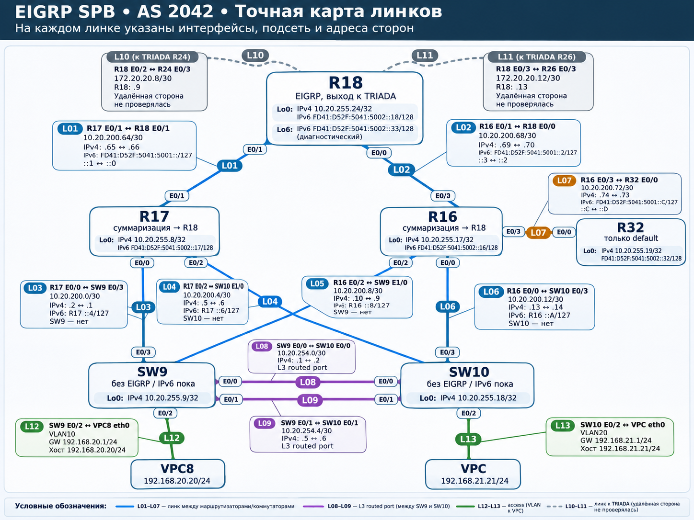

# EIGRP Named Mode: Санкт-Петербург — AS 2042

Домашнее задание **OTUS «Сетевой инженер. Продвинутый уровень»**.  
**Данные:** сохранённый экспорт `2020-02.unl` из архива EVE-NG от **17 ноября 2026 года**; CLI-проверки от 15–16 ноября 2026 года.  
**Оборудование:** Cisco IOS IOL в EVE-NG; EIGRP Named Mode, IPv4 и IPv6.

> **Краткий отчёт:** R16, R17, R18 и R32 проверены по конфигурациям и выводу CLI. SW9 и SW10 пока не включены в EIGRP, и IPv6. Сети SW9/SW10 в работе показаны как фактически сконфигурированные, а не как проверенные сквозной связностью. Планирую завершить их настройку отдельно.

## Содержание

- [Задача и статус](#задача-и-статус)
- [Точная схема линков](#точная-схема-линков)
- [Адресный план](#адресный-план)
- [Принципы конфигурации EIGRP](#принципы-конфигурации-eigrp)
- [Суммаризация и её ограничения](#суммаризация-и-её-ограничения)
- [Результаты проверок](#результаты-проверок)
- [Эксперименты и исправления](#эксперименты-и-исправления)
- [Состояние SW9/SW10 и что остаётся](#состояние-sw9sw10-и-что-остаётся)
- [Выгрузки конфигураций и безопасность](#выгрузки-конфигураций-и-безопасность)
- [Команды контроля](#команды-контроля)

## Задача и статус

| Требование/цель | Реализация | Статус |
|---|---|---|
| Единый EIGRP Named Mode AS 2042 | Процесс `SPB` с AF IPv4 и IPv6 на R16/R17/R18/R32 | **Подтверждено** |
| R16/R17 анонсируют агрегаты к R18 | Разделённые IPv4 P2P, Loopback и IPv6 P2P | **Частично:** есть исключения, не агрегировал единичные адреса на устройствах|
| R32 получает только default | `summary-address 0.0.0.0/0` и `summary-address ::/0` на R16 E0/3 | **Подтверждено по RIB R32** |
| Проверена реальная пересылка | ICMP между Loopback R16/R17/R18/R32 | **70/70 успешных Echo** в проверенных сериях |
| SW9/SW10 участвуют в EIGRP и IPv6 | Пока только IPv4-интерфейсы, два routed линка между SW | **Не требовалось в задании. Будет выполнено позже** |
| Адреса на схеме согласованы с конфигами | Все линк-ID L01–L13 и концы из файла лаборатории | **Проверено** |

## Точная схема линков



[Открыть схему отдельным PNG](assets/spb-links-precise.png) · [векторный SVG](assets/spb-links-precise.svg) · [исходный фрагмент схемы EVE-NG](assets/source-spb.png).

**Как читать:** обозначение `Lxx` на конкретном кабеле однозначно указывает на строку справа: **интерфейс A ↔ интерфейс B, сеть и IP каждого конца**. Подписи на исходном скриншоте устарели после перенумерации; для отчёта актуальны только выгруженная конфигурация и схема выше.

Особенность: **SW9 E0/0 ↔ SW10 E0/0 (L08)** и **SW9 E0/1 ↔ SW10 E0/1 (L09)** — два разных **L3 P2P-соединения**. На обоих концах настроено `no switchport`; это не L2-транки.

## Адресный план

### Loopback0

| Устройство | IPv4 | IPv6 | EIGRP Router ID |
|---|---|---|---|
| R16 | `10.20.255.17/32` | `FD41:D52F:5041:5002::16/128` | `16.16.16.16` |
| R17 | `10.20.255.8/32` | `FD41:D52F:5041:5002::17/128` | `17.17.17.17` |
| R18 | `10.20.255.24/32` | `FD41:D52F:5041:5002::18/128` | `18.18.18.18` |
| R32 | `10.20.255.19/32` | `FD41:D52F:5041:5002::32/128` | `32.32.32.32` |
| SW9 | `10.20.255.9/32` | **не назначен** | EIGRP не настроен |
| SW10 | `10.20.255.18/32` | **не назначен** | EIGRP не настроен |

**Служебные Loopback R18:** `Loopback18 = 172.16.255.18/32` и `Loopback6 = FD41:D52F:5041:5002::33/128`. Они оставлены для экспериментов с default, фильтрацией и `Null0`; первый IPv4-адрес не включён в EIGRP IPv4 командой `network 10.0.0.0`.

### Межмаршрутизаторские и маршрутизируемые P2P

В IPv6 применяется ULA `FD41:D52F:5041::/48`, блок `FD41:D52F:5041:5001::/64` для P2P и `FD41:D52F:5041:5002::/64` для Loopback. В таблице приведены **полные** адреса.

| ID | Интерфейс A и IPv4 | Интерфейс B и IPv4 | IPv4-подсеть | IPv6-подсеть и концы |
|---|---|---|---|---|
| L01 | R17 E0/1 `10.20.200.65` | R18 E0/1 `10.20.200.66` | `10.20.200.64/30` | `…:5001::/127`, R17 `…::1`, R18 `…::` |
| L02 | R16 E0/1 `10.20.200.69` | R18 E0/0 `10.20.200.70` | `10.20.200.68/30` | `…:5001::2/127`, R16 `…::3`, R18 `…::2` |
| L03 | R17 E0/0 `10.20.200.2` | SW9 E0/3 `10.20.200.1` | `10.20.200.0/30` | R17 `…:5001::4/127`, SW9 нет |
| L04 | R17 E0/2 `10.20.200.5` | SW10 E1/0 `10.20.200.6` | `10.20.200.4/30` | R17 `…:5001::6/127`, SW10 нет |
| L05 | R16 E0/2 `10.20.200.10` | SW9 E1/0 `10.20.200.9` | `10.20.200.8/30` | R16 `…:5001::8/127`, SW9 нет |
| L06 | R16 E0/0 `10.20.200.13` | SW10 E0/3 `10.20.200.14` | `10.20.200.12/30` | R16 `…:5001::A/127`, SW10 нет |
| L07 | R16 E0/3 `10.20.200.74` | R32 E0/0 `10.20.200.73` | `10.20.200.72/30` | `…:5001::C/127`, R16 `…::C`, R32 `…::D` |
| L08 | SW9 E0/0 `10.20.254.1` | SW10 E0/0 `10.20.254.2` | `10.20.254.0/30` | нет |
| L09 | SW9 E0/1 `10.20.254.5` | SW10 E0/1 `10.20.254.6` | `10.20.254.4/30` | нет |
| L10 | R18 E0/2 `172.20.20.9` | TRIADA R24 E0/3 — не проверен | `172.20.20.8/30` | нет |
| L11 | R18 E0/3 `172.20.20.13` | TRIADA R26 E0/3 — не проверен | `172.20.20.12/30` | нет |

Для компактности `…` в столбце IPv6 разворачивается в `FD41:D52F:5041` (например, `…:5001::A` = `FD41:D52F:5041:5001::A`).

### Сети доступа

| ID | Порт | Режим | Шлюз/SVI | Статус |
|---|---|---|---|---|
| L12 | SW9 E0/2 → VPC8 eth0 | `switchport mode access`, VLAN10 | SW9 `Vlan10 = 192.168.20.1/24` | VPC8 `192.168.20.20/24`, default gateway `192.168.20.1`; IP извлечён из файла VPC, ping не проверен |
| L13 | SW10 E0/2 → VPC eth0 | `switchport mode access`, VLAN20 | SW10 `Vlan20 = 192.168.21.1/24` | VPC `192.168.21.21/24`, default gateway `192.168.21.1`; IP извлечён из файла VPC, ping не проверен |

## Принципы конфигурации EIGRP

- На R16/R17/R18/R32 процесс `router eigrp SPB` содержит две Address-Family `ipv4 unicast autonomous-system 2042` и `ipv6 unicast autonomous-system 2042`.
- `af-interface default` → `passive-interface` не формирует соседства на всех интерфейсах по умолчанию. Командой `no passive-interface` явно разрешены нужные Ethernet-линки. Loopback пассивен, но анонсируется, если включён в AF.
- В IPv4 `network 10.0.0.0` на R16/R17/R18 охватывает все подходящие интерфейсы 10/8. На R32 отдельное точное правило `network 10.20.255.19 0.0.0.0` исправило пропавший анонс Loopback после перенумерации.
- В EIGRP IPv6 отдельная команда `network` не нужна; используется IPv6-адресация интерфейсов и политика AF.
- Состояние `P` (Passive) в DUAL означает стабильный маршрут.
- IPv6 EIGRP next-hop вида `FE80::...` — это link-local адрес соседнего маршрутизатора.

## Суммаризация и её ограничения

| Откуда → куда | IPv4 summary | IPv6 summary |
|---|---|---|
| R17 E0/1 → R18 | `10.20.200.0/29`, `10.20.255.8/31` | `FD41:D52F:5041:5001::4/126` |
| R16 E0/1 → R18 | `10.20.200.8/29`, `10.20.255.16/29` | `FD41:D52F:5041:5001::8/125` |
| R16 E0/3 → R32 | `0.0.0.0/0` | `::/0` |

Оба P2P-агрегата IPv4 R16/R17 и оба P2P-агрегата IPv6 не пересекаются. На R18 для каждого показан единственный Successor. IPv6-агрегат R16 `…::8/125` покрывает `::8/127`, `::A/127`, `::C/127` и резервный `::E/127`.

**Исключения из буквального требования «только суммарные префиксы»:** R16 отдельно анонсирует `10.20.200.72/30` (соединение R16–R32), а IPv6 Loopback R16/R17/R32 остаются `/128`. Это **частичное выполнение** требования; поэтому не заявляю полную суммаризацию всех префиксов.

**Риск Null0:** локальные `summary-address` создают суммарные discard-маршруты. На R16 префикс `10.20.255.16/29` ведёт в Null0, но более специфичный маршрут к R32 `10.20.255.19/32` через `10.20.200.73` имеет приоритет. Для Loopback SW10 `10.20.255.18/32` специфичный маршрут не обнаружен в последней RIB R16, так как EIGRP на SW10 отсутствует. Следовательно, трафик к этому адресу может отбрасываться в Null0 до завершения SW-конфигурации. Аналогично на R17 агрегат `10.20.255.8/31` включает SW9 `10.20.255.9/32`, которого нет в EIGRP RIB. **Суммаризация не заменяет маршруты к фактическим получателям.**

## Результаты проверок

### R18 — маршруты

```text
IPv4  10.20.200.0/29    via 10.20.200.65 (R17)
IPv4  10.20.200.8/29    via 10.20.200.69 (R16)
IPv4  10.20.200.72/30   via 10.20.200.69 (R16), исключение
IPv4  10.20.255.8/31    via 10.20.200.65 (R17)
IPv4  10.20.255.16/29   via 10.20.200.69 (R16)
IPv6  FD41:D52F:5041:5001::4/126 via R17
IPv6  FD41:D52F:5041:5001::8/125 via R16
```

На R18 подтверждены по два EIGRP-соседа для IPv4 и IPv6, очередь `Q Cnt=0`, DUAL `P` для агрегатов.

### R32 — только два default-маршрута

```text
D* 0.0.0.0/0 [90/1024640] via 10.20.200.74, Ethernet0/0
D  ::/0      [90/1024640] via FE80::A8BB:CCFF:FE01:30, Ethernet0/0
```

Иных **изученных через EIGRP** маршрутов на R32 нет; непосредственно подключённые C/L сохранены. Это подтверждает default-only политику.

### ICMP

| Направление | Проверенные назначения | Результат |
|---|---|---|
| R18 → R17/R16/R32 | IPv4 и IPv6 Loopback работающих маршрутизаторов | **30/30** |
| R32 → R17/R16/R18 | IPv4 и IPv6 Loopback | **30/30** |
| R17 Loopback0 → R32 Loopback0 | IPv4 и IPv6, источник явно `Loopback0` | **10/10** |
| R18 → SW9 `10.20.255.9` | SW9 был выключен; получил `U.U.U` | **0/5**, не засчитывается как ошибка работающего EIGRP-ядра |

Суммарно для работающих и проверенных маршрутизаторов: **70 успешных Echo из 70**. Эта статистика **не подтверждает** доступность SW/VPC и отдельных неанонсированных адресов. Подробности: [ping-results.md](evidence/ping-results.md), [routing-verification.md](evidence/routing-verification.md).

## Эксперименты и исправления

1. **Перекрывающиеся агрегаты и ECMP:** первоначально R16/R17 анонсировали одинаковый `10.20.200.0/28`; R18 устанавливал ECMP, а трафик к отдельным сетям мог попадать в `Null0` на неправильном суммирующем узле. Решение — разделить IPv4-подсети под независимые агрегаты `/29`.
2. **Роль статического default:** R16 отправляет R32 summary defaults; это не означает, что у самого R16 существует реальный путь к произвольной сети. На R18 созданы диагностические Loopback18/Loopback6; при отсутствии более специфичных маршрутов/статического default трафик попадал в Null0.
3. **IPv6 входная фильтрация:** в эксперименте R16 использовал `LOOP_6_deny_test` для исключения IPv6 Loopback6. **Состояние экспорта:** сам `ipv6 prefix-list` присутствует, но `distribute-list` в сохранённой конфигурации EIGRP уже **отсутствует**: фильтр не применяется.
4. **Точное правило `network` на R32:** после изменения Loopback0 на `10.20.255.19/32` ранее узкий `network` не включал адрес; после исправления R16 увидел конкретный `/32`, и связность восстановилась.

Подробнее: [experiments-and-limitations.md](evidence/experiments-and-limitations.md).

## Состояние SW9/SW10 и что остаётся

По **фактическому экспорту** `SW9.cfg` и `SW10.cfg`:

- Есть IPv4-подсети линков к R16/R17, к другому SW, Loopback и SVI VLAN10/VLAN20; `no switchport` на обоих линках SW9–SW10.
- **Нет** секции `router eigrp`, настроенных IPv6-адресов или команды `ipv6 unicast-routing`.
- Поэтому **не подтверждены** соседства R16↔SW9/SW10 и R17↔SW9/SW10, маршруты к `10.20.255.9/32` и `10.20.255.18/32`, а также достижимость сетей VPC за коммутаторами. Адреса VPC известны из сохранённых конфигураций, но не проверены ping.
- При будущей настройке проверить L3-маршрутизацию на SW, участие нужных интерфейсов/Loopback/SVI в EIGRP, IPv6 `/127` на P2P и `/128` на Loopback, соседства, return path до клиентов. После этого актуализировать маршрутные и ping-доказательства.


## Выгрузки конфигураций и безопасность

Каталог [`configs/`](configs/) содержит **шесть полноразмерных сохранённых конфигураций маршрутизаторов/коммутаторов**:

- [`R16.cfg`](configs/R16.cfg), [`R17.cfg`](configs/R17.cfg), [`R18.cfg`](configs/R18.cfg), [`R32.cfg`](configs/R32.cfg)
- [`SW9.cfg`](configs/SW9.cfg), [`SW10.cfg`](configs/SW10.cfg)


Отдельно: [сверка экспорта](evidence/export-audit.md) — адреса, недостатки конфигурации SW и оставшиеся проверки. Прежние фрагменты R16/R17/R32 заменены полными сохранёнными конфигурациями.

## Команды контроля

| Команда | Назначение |
|---|---|
| `show running-config \| section ^router eigrp` | Показать AF EIGRP, summary, passive и фильтры |
| `show ip eigrp neighbors` / `show ipv6 eigrp neighbors` | Соседства, uptime, Q Cnt |
| `show ip eigrp topology` / `show ipv6 eigrp topology` | DUAL, successors, FD/RD и P/A |
| `show ip route` / `show ipv6 route` | RIB, Null0, default, конкретные префиксы |
| `show ip route 10.20.255.18` | Куда R16 отправит пакеты к SW10 Loopback |
| `show ip route 10.20.255.9` | Куда R17 отправит пакеты к SW9 Loopback |
| `show ip protocols` | Проверить включённые `network` в IPv4 AF |
| `show ipv6 prefix-list` | Проверить определение диагностического фильтра |
| `ping 10.20.255.19 source Loopback0` | Проверить IPv4 между Loopback R17/R32 |
| `ping FD41:D52F:5041:5002::32 source Loopback0` | Проверить IPv6 между Loopback R17/R32 |

## Структура архива

```text
otus-eigrp-spb-v2/
├── README.md
├── assets/
│   ├── spb-links-precise.png
│   ├── spb-links-precise.svg
│   └── source-spb.png
├── configs/
│   ├── R16.cfg
│   ├── R17.cfg
│   ├── R18.cfg
│   ├── R32.cfg
│   ├── SW9.cfg
│   ├── SW10.cfg
│   ├── VPC8.cfg
│   └── VPC.cfg
└── evidence/
    ├── export-audit.md
    ├── routing-verification.md
    ├── ping-results.md
    └── experiments-and-limitations.md
```


